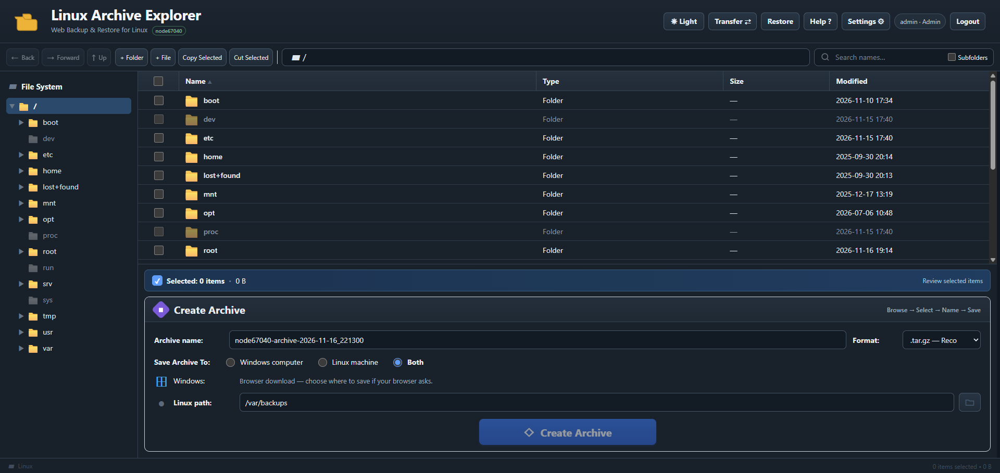

# Linux Archive Explorer

**Browse, manage, edit, archive, transfer, and restore files on Linux from your web browser.**

Linux Archive Explorer provides a familiar file-manager interface for Linux machines. Browse folders, manage files, make TAR or ZIP backups, save archives to Linux or download them to your computer, transfer files between Windows and Linux, and inspect an archive before restoring it. A built-in text editor handles ordinary text and configuration files. The interface supports Light and Dark themes, desktop browsers, and separate Administrator and User accounts. Mobile phones are not supported.

<p align="center">
  <a href="screenshot.png"></a>
</p>

Linux Archive Explorer is a **general-purpose Linux application**. It works independently of other application stacks and uses the hostname of whichever Linux machine it is installed on.

> **Before using Restore:** Restoring an archive writes files to their original Linux paths and can replace existing files. Read the preview and warnings carefully. Keep a separate system backup before restoring important system directories.

### Contents

[Features](#features-at-a-glance) · [Installation and updates](#first-time-installation) · [Explorer controls](#using-the-file-explorer) · [Text editor](#built-in-text-and-configuration-editor) · [Creating archives](#creating-a-backup-archive) · [Viewing and Restore](#viewing-verifying-and-restoring-archives) · [Windows transfer](#transferring-files-between-windows-and-linux) · [Settings and users](#settings-users-and-appearance) · [Storage safety](#storage-housekeeping-and-safety) · [Configuration](#application-files-and-configuration) · [Troubleshooting](#troubleshooting)

## Features at a glance

| Feature | What you can do |
|---|---|
| **Linux file explorer** | Navigate folders using a prominent directory-path bar, Back/Forward/Up, sorting, search, multiple selection and a right-click menu |
| **File management** | Create new folders or empty files; copy, cut, paste, rename, move and delete files or folders with safeguards |
| **Text and configuration editor** | Open regular UTF-8 text files, edit them, find text, compare changes and save with a safety backup |
| **Create archives** | Create `.tar`, `.tar.gz`, `.tar.xz`, `.tar.zst` or `.zip` archives from selected files and folders |
| **Choose where to save** | Save an archive on Linux, download it to Windows, or do both |
| **Archive viewer** | Open an archive to examine its entries and integrity information without restoring it |
| **Protected Restore** | Inspect an archive, preview original paths, confirm the changes, and retain a recovery option |
| **Restore History** | Verify, protect, roll back, or delete eligible retained Restore recovery packages |
| **Windows ↔ Linux Transfer** | Drag and drop files, use Ctrl+V, and transfer selected files using two file panes |
| **Accounts and appearance** | Administrator/User roles, password controls, session timeout, Help, and persistent Light/Dark themes |
| **Automatic housekeeping** | Clean temporary files and apply bounded recovery retention while leaving deliberately saved archives alone |

## Requirements

| Component | Requirement |
|---|---|
| Linux server | Debian GNU/Linux 13 (Trixie), on `arm64` or `amd64` |
| Web server | Apache and PHP, configured by the setup script |
| Archive tools | GNU tar and the compression/ZIP dependencies installed by setup |
| Administration | Terminal access with `sudo` for installation and system maintenance |
| Browser | Modern desktop browser; mobile phones are not supported. Direct Windows-folder access has additional browser-permission requirements |
| Networking | Trusted local-network access, or correctly configured HTTPS when accessible outside a trusted network |

The interface is intended to be useful across Linux distributions, but **do not assume the installer supports a distribution until it has been validated there**. The current installer checks its supported operating system and architecture instead of making unverified changes.

## First-time installation

On Debian 13:

```bash
sudo mkdir -p /var/www
cd /var/www
sudo git clone https://github.com/TerryClaiborne/linux-archive-explorer.git linux-archive-explorer
cd /var/www/linux-archive-explorer
sudo ./setup_linux_archive_explorer.sh
```

The single setup script installs required dependencies, starts Apache when necessary, and prompts for the initial Administrator account. If Apache is already installed, Linux Archive Explorer adds only its own integration and leaves unrelated web-server configuration in place.

A successful normal setup prints a short progress header showing whether it is Installing, Updating, or Repairing, followed by the final installation result, login username, usable browser URL, and saved-archive path. Routine certificate details, trust-store instructions and TCP 443 notices are not printed. If setup cannot complete safely, it prints an error instead. On a clean machine without an existing HTTPS endpoint, setup can provision an isolated Linux Archive Explorer HTTPS endpoint so browser features that require a secure context can work. Existing Apache/HTTPS configuration is preserved rather than replaced.

### Updating

From the same source directory:

```bash
cd /var/www/linux-archive-explorer
sudo git pull origin main
sudo ./setup_linux_archive_explorer.sh
```

Use that **same setup command** for full updates or small changes, including a README correction. Existing accounts, configuration, archives and protected data are kept. Setup verifies a pre-update recovery backup, and keeps no more than one verified previous-installation recovery point after a successful update. The application does not silently install GitHub updates itself.

### Optional setup commands

Only these maintenance commands are supported, in addition to normal setup and `--help`:

| Command | Purpose |
|---|---|
| `sudo ./setup_linux_archive_explorer.sh` | Install or update with concise progress output; preserve accounts, configuration, archives, recovery |
| `sudo ./setup_linux_archive_explorer.sh --repair` | Reinstall application code and integration, preserving user data |
| `sudo ./setup_linux_archive_explorer.sh --verify` | Run the detailed security, permission and health verification report |
| `sudo ./setup_linux_archive_explorer.sh --change-password` | Recover or change the Administrator login password |
| `sudo ./setup_linux_archive_explorer.sh --uninstall` | **Permanently remove Linux Archive Explorer after typing UNINSTALL; safely reverse only first-install packages proven by the installer ledger** |

The application uses **one directory**, `/var/www/linux-archive-explorer/`. The Git checkout, installer and source files live there, with the served runtime in its `current/` subdirectory and protected data in sibling directories. No separate `linux-archive-explorer-source` directory is created or needed. The `current/` subdirectory is *not* a second application installation.


Normal setup and Repair print a concise progress header followed by the final four-line completion result. Password change, uninstall cancellation and uninstall stay concise; `--verify` prints the detailed verification report. The installer refuses lifecycle changes while protected work is active and uses an exclusive lock so two setup operations cannot overlap. `--uninstall` is the only uninstall mode: it removes LAE-owned state/integration and, when a valid first-install ledger exists, reverses only packages proven to have been introduced by LAE and safe for removal. Pre-existing/shared packages and unrelated Apache configuration are preserved.

Linux Archive Explorer does not change Tailscale configuration. If an existing usable Apache HTTPS endpoint is present, setup preserves it. On a clean machine without one, setup can provision an isolated LAE HTTPS endpoint for secure-context browser features. Routine certificate/trust details and TCP 443 notices are suppressed from successful normal installer output.

## Using the file explorer

The main view works similarly to a desktop file manager. The **single compact toolbar row** contains **Back / Forward / Up**, **+ Folder / + File**, **Copy Selected / Cut Selected**, the current Linux directory path, and **Search / Subfolders**, in that order. The buttons are slightly smaller so the directory path stays visible above the folder listing. Double-click a Linux folder to open it; use Back, Forward, Up, or the path bar to navigate. File and folder rows have selection controls, and the interface shows how many items are selected. The same checkbox selection can be used for **Create Archive**, **Copy Selected**, or **Cut Selected**; checking a box does not automatically create an archive or move a file.

| Control or gesture | What it does |
|---|---|
| Double-click a folder | Open that folder |
| Back / Forward / Up | Move through browsing history or to a parent folder |
| Directory path bar | Shows the current Linux directory prominently; select a path component to jump to it |
| Checkboxes / Select All | Select one, several, or all visible items for archiving or multiple-item file actions |
| Ctrl+Click / Shift+Click | Add individual items or a range to the selection |
| Right-click a row | Open available file, archive or folder actions |
| **+ Folder / + File** | Create a new folder or empty file directly from the main toolbar, even when there is no blank file-list space |
| **Copy Selected / Cut Selected** | Use the checked items as the source for a Linux Copy or Move; then Paste in the destination |
| Right-click empty space | Open the current-folder menu (Refresh, New Folder, New File, and Paste when available) |
| Click empty space | Clear the current selection |
| Search | Filter names in the current folder |
| **Subfolders** + Search | Search names below the current folder, with their locations shown |
| **Open location** (search result) | Open the containing directory and highlight the result |
| Help / tooltips | Explain actions without leaving the application |

**Protected system folders** such as `/dev`, `/proc`, `/sys`, and `/run` remain visible but are greyed out in the left folder tree and the main file list (both Light and Dark themes). They cannot be expanded, opened or selected for archiving through the Explorer; hover to see why. Application-private workspaces have similar protection.

**Search is by filename or folder name, not by file contents.** Recursive search is bounded to protect the machine from excessively large searches; narrow the starting directory if the search reports partial results. It does not follow other mounted filesystems or protected virtual directories.

### Managing Linux files and folders

Administrators can create folders, rename, copy, cut/move and delete files and directories. The right-click menu offers actions appropriate to the item and the signed-in account.

| Action | How it works |
|---|---|
| **New Folder** | Create a folder in the currently displayed Linux directory, from the toolbar or background right-click menu |
| **New File** | Create an empty file by entering a filename in the current Linux directory; existing files are never overwritten |
| **Copy Selected / Cut Selected** | Copy or move the items checked in the file list. Open the destination and choose Paste Here |
| **Copy** | Prepare a duplicate; the source remains intact |
| **Cut** | Prepare a move; the source is not moved until Paste succeeds |
| **Paste Here** | Copy or move into the currently displayed directory |
| **Paste Into Folder** | Copy or move into the specific folder chosen in the menu |
| **Rename** | Change a file or folder name with checks for conflicts |
| **Delete** | Use a protected deletion path rather than silently removing recoverable material |
| **Properties** | Inspect the selected item's available details |

If a destination already contains an item with the same name, a **centered conflict dialog** lets you choose **Replace**, **Keep Both**, **Skip**, or **Cancel**. For an existing folder, **Merge Folder** is available for applicable copy operations. The optional **Apply to remaining** checkbox reuses that choice only during the current transfer; replacements require explicit approval. Replaced Linux files first receive a protected recovery copy, subject to the protected Delete size limit.

The Linux file-management clipboard is **separate from the Windows clipboard**. For Windows files, use Transfer, drag-and-drop, or a browser download. Conflicts are never silently overwritten. Critical destinations, including the Linux filesystem root (`/`), require an additional typed confirmation. The application protects its own installation and working directories from ordinary file-management operations.

## Built-in text and configuration editor

Linux Archive Explorer includes a real text editor—there is no need to download a configuration file, change it on Windows and upload it again. **In Main Explorer or the Linux pane of Transfer**, an Administrator can double-click a regular text file, or right-click it and choose **Open / Edit Text…**. The file is inspected by content; binary files are refused. In Transfer, closing the editor returns to the same Transfer directory.

**To open a file:** Double-click a regular text file, or right-click it and choose **Open / Edit Text**. The application detects supported plain UTF-8 text by its contents, not by its filename extension. Files such as `config.ini`, `README.md` and extensionless configuration files can be opened if they meet the safety rules.

| Editor control or behavior | Description |
|---|---|
| Line numbers | Display line numbers alongside the text |
| Find / Find Next | Search inside the file currently open in the editor |
| **Review Changes** | Compare the opened content with your unsaved edits |
| Previous / Next Change | Navigate differences in the change review |
| **Save Changes** | Check for conflicts, make a protected pre-edit copy, then write atomically |
| **Review Last Save** | After saving, reopen the same file to compare the before/after version during the current browser session |
| Cancel / Close | Leave without saving; unsaved edits require confirmation |

**Editing files inside Linux Archive Explorer itself:** Administrators may edit the root-level ordinary text documents `README.md`, `SECURITY.md`, `config.ini.example`, `tree.txt`, `VERSION` and `LICENSE` from the browser. A `SAVE` confirmation and protected pre-edit backup are required. Live `config.ini`, the installed runtime, executable source, Git metadata, archives, accounts, and private/recovery data remain protected; use the installer or Settings for application changes.

The editor supports regular UTF-8 text files of up to **5 MiB**. It refuses binary files, symlinks and unsupported multi-hard-link targets. It checks whether another process changed the file before saving and aims to preserve ownership, permissions and line-ending style. Sensitive system paths require typing `SAVE`. Only Administrators can edit Linux files.

**Review Last Save is a temporary browser comparison**, not a permanent revision-history viewer. Separate pre-edit recovery copies follow the application's controlled retention policy.

## Creating a backup archive

1. Browse to the files or folders you want to back up and select them.
2. Select **Create Archive**.
3. Review or change the suggested archive name and choose a format.
4. Choose where to save it: **Linux**, **Windows**, or **Both**.
5. Start creation and review the result and verification information.

The machine hostname appears beside the application subtitle in a subtle green oval. The suggested filename automatically uses that same Linux machine **system hostname** (the hostname normally shown by `hostnamectl`), so archives from different computers can be distinguished. For example, backing up Documents on machines named `workstation` and `homeserver` produces different suggested names. You may edit the filename before creating the archive.

| Format | When to use it | Linux metadata |
|---|---|---|
| `.tar.gz` | General-purpose compressed Linux backup | Recommended |
| `.tar.zst` | Zstandard-compressed TAR | Recommended |
| `.tar.xz` | More compact TAR, usually slower | Recommended |
| `.tar` | Uncompressed TAR | Recommended |
| `.zip` | Easy access on Windows and other platforms | Not as complete as TAR |

TAR is preferred when permissions, ownership, links and other Linux metadata matter. ZIP is useful for portability but is not a substitute for a metadata-faithful Linux system backup.

When a selected folder contains Linux Archive Explorer itself, the application excludes its own temporary staging, jobs, uploads, logs, and recovery/rollback workspaces. This prevents a backup from including a copy of the archive while it is being created. These runtime areas therefore are **not** included in the saved archive; do not rely on such a backup as a complete system image. Restoring an application installation or its configuration is a critical operation and requires the explicit Restore safety workflow.

### Where archives go

| Destination | Behavior |
|---|---|
| **Linux** | Save a verified permanent archive to the selected Linux directory; `/var/backups/` is suggested where available |
| **Windows** | Create a verified temporary archive and offer **Download to Windows**; your browser controls where it saves the file |

**Choose your Windows download folder:** In Google Chrome, open **Settings → Downloads** and enable **Ask where to save each file before downloading**. Chrome will then let you choose the folder for each archive download instead of automatically saving everything to Downloads.

| **Both** | Keep a permanent Linux copy and offer a Windows download |

After creation, **Open Archive** displays the archive's verified contents without restoring files. For Windows downloads, this preview can remain available after the server removes its temporary copy. **A successful server download does not prove the browser saved the Windows file correctly.** To check your saved copy independently, open **Restore → From Windows**, select the downloaded file and inspect it.

Archive integrity is displayed using SHA-256. Ordinary saved archives do **not** accumulate automatic `.sha256` sidecar files.

## Viewing, verifying and restoring archives

Select a supported archive in the explorer to view its contents, inspect integrity information, download it, or start Restore. **Opening or inspecting an archive does not modify the Linux filesystem.**

### Restore from Windows or Linux

1. Choose **Restore** and select **From Windows** or **From Linux**.
2. Select the archive. For a Windows copy, choose the actual saved file in your browser's file picker.
3. Choose **Inspect Archive**. Inspection checks the archive's embedded manifest, entries and original Linux paths before permitting a restore.
4. Review the preview, source hostname and proposed destination paths. Use **Inspect Again** if necessary.
5. Choose **Continue to Restore** and read the warning.
6. Confirm the operation. Critical system restores and archives from another hostname require typing `RESTORE`.
7. The application creates and verifies a pre-restore recovery package, performs the Restore and checks the result.

The manifest records the source machine identity and operating-system information. If an archive came from **another Linux computer**, the application warns you: restoring it will write its original absolute paths **on the current computer**. It does not automatically translate those paths. Check them before proceeding.

Linux Archive Explorer restore requires its own valid archive manifest. A TAR or ZIP file produced independently by other archiving software may be perfectly readable but **cannot be treated as a restorable Linux Archive Explorer backup** without the required manifest.

### Restore History

The **Restore History** panel lets Administrators manage recovery packages created by previous Restore operations:

| Action | Result |
|---|---|
| **Verify** | Recheck a retained recovery package without changing files |
| **Rollback** | Restore the state that existed before the associated Restore, after typing `ROLLBACK` |
| **Protect / Unprotect** | Control whether an eligible recovery package may be cleaned up automatically |
| **Delete** | Permanently delete an eligible unprotected package after typing `DELETE` |

Successful unprotected recovery packages have bounded retention. Active, failed, critical or explicitly protected recovery packages are handled more conservatively and may require an Administrator's decision. Restore and Rollback are sensitive operations: keep an independent system backup for important machines.

## Transferring files between Windows and Linux

Choose **Transfer** to open the two-pane Linux/Windows transfer view. **Drag files or folders directly from either pane onto the opposite pane** to copy them. Drop onto a folder row to copy inside that folder, or onto blank space for the open directory. Highlighting shows the drop destination. Multiple selected items can be dragged together. Dragging **copies**; it never deletes the original.

| You want to… | Method |
|---|---|
| Copy Windows → Linux | Drag a file/folder from the Windows pane to the Linux pane or a Linux folder |
| Copy Linux → Windows | Click **Choose Folder** to authorize Windows access, then drag from Linux to Windows or a Windows folder |
| Copy multiple items | Select with checkboxes, Select All or Ctrl/Shift-click, then drag a selected row |
| Copy from Windows Explorer | Drop files/folders from Windows Explorer onto the Linux pane |
| Paste copied Windows files | Copy in Windows Explorer, focus Transfer, press **Ctrl+V** |
| Alternate method | Select items and click **To Linux** or **To Windows**; without authorized Windows folder access, To Windows requests a browser download |
| Open a folder | Double-click the row, or select it and press Enter |
| Navigate Windows above authorized root | Use Windows **Up** at the root to reopen **Choose Folder** and authorize a higher/different folder |
| Manage files without leaving Transfer | Right-click in either pane for **Copy, Cut, Paste, Rename, Delete**; Linux also offers **Properties**. Paste can target the open folder or a specific folder row. |

**Transfer right-click menus:** Transfer has its **own clipboard**, separate from the main Explorer, so Copy/Cut/Paste choices in Transfer never create Paste choices on the main screen. Copy or Cut on either Transfer pane can be pasted into either pane: Linux→Linux, Linux→Windows, Windows→Linux, or Windows→Windows. Paste labels identify the source when crossing panes. Linux actions use the same protected file-management, recovery and critical-path safeguards as the main Explorer. On Windows, actions operate only inside the folder tree you explicitly authorized in the browser. **Cut never removes a source until that entire source item has copied successfully.** If a child is skipped, cancelled, blocked, or otherwise incomplete, the source item is retained. Windows deletes use the browser-authorized folder directly and do not create a Linux Archive Explorer recovery copy, so the confirmation is explicit.

**Windows folder access:** direct browsing, rename/delete and direct Linux → Windows writes use Chrome's File System Access API, which is available only in a **secure context**. Use the usable HTTPS address printed by setup for the full Windows File System Access experience. On a clean machine without an existing HTTPS endpoint, setup can provision an isolated LAE HTTPS endpoint; it does not alter Tailscale or overwrite unrelated Apache HTTPS configuration. On plain HTTP, drag/drop/paste to Linux and browser downloads still work, but those are fallbacks rather than full two-pane Windows file management.

For duplicate names, a centered dialog offers **Replace**, **Keep Both**, **Skip**, and **Cancel**; compatible folders also offer **Merge Folder**, plus **Apply to remaining** for that batch. Linux replacements retain an eligible protected safety copy; on the Windows side, Replace writes to the existing Windows file after explicit approval, so choose Keep Both if you want to retain the original. No existing file is silently overwritten. Transfers into critical Linux directories require an explicit warning and confirmation. File lists refresh after successful changes.

You should not need to leave a folder and come back after a successful move, rename, delete, or transfer. The Explorer and Transfer panes refresh to reflect completed operations. Closing Transfer clears its temporary Copy/Cut clipboard state so it cannot leak into later Explorer work.

## Settings, users and appearance

Linux Archive Explorer starts with an Administrator login and supports additional accounts.

| Permission | Administrator | User |
|---|:---:|:---:|
| Browse and search Linux files | Yes | Yes |
| Create, inspect and download archives | Yes | Yes |
| Edit, rename, move, delete or upload Linux files | Yes | No |
| Restore and Rollback | Yes | No |
| Manage users and application defaults | Yes | No |
| Review/reset application temporary storage | Yes | No |

**My Account** lets you change your own password using your current password. Administrators can add users, change another user's role or enabled status, and use a separate **Reset Password** action. The application protects the currently signed-in account and the last enabled Administrator from accidental removal or demotion.

In **Settings**, Administrators can choose the default archive format, select the idle sign-out period (**15, 30, 60 or 120 minutes**), and use **Cleanup & Storage** to review application disk use and initiate guarded cleanup. That reset requires typing `RESET`; it is **not a factory reset** and does not remove permanent archives, accounts or configuration.

The Light/Dark theme switch persists across sessions. Help and control tooltips are available inside the application. The upper-left repository icon shows version information and can link to the project page; it never installs updates automatically.

## Account management

The first installation creates an Administrator account. Administrators can add or disable User accounts, reset another user's password, and adjust roles without editing configuration files. Each signed-in user can change their own password under **My Account**. The final enabled Administrator cannot be removed.

## Storage housekeeping and safety

Backups are only useful if the backup tool does not fill the disk itself. Linux Archive Explorer checks available space before starting space-intensive operations, imposes limits on temporary and eligible recovery storage, and removes abandoned temporary files automatically. On an installed system, a root-owned scheduled cleanup task works even when the browser is closed.

| Directory or data | General retention rule |
|---|---|
| `staging/` | Temporary archive/download workspace; completed copies are released and abandoned work expires |
| `uploads/` | Temporary Windows→Linux transfer/Restore files; bounded and automatically cleaned |
| `rollback/installer/` | At most one verified previous-installation backup after a successful update |
| `rollback/edits/`, `rollback/trash/` | Short, bounded recovery retention for eligible completed file operations |
| Restore History | Bounded unprotected retention, with protections for active/critical/failed recovery |
| `jobs/`, `logs/` | Expiration or rotation limits |
| Permanent user archives | **Never automatically deleted by temporary-storage cleanup** |
| Application configuration and accounts | **Preserved** |

If sufficient safe free space is unavailable, the application should refuse the operation rather than proceed recklessly. Explicitly protected recovery data can require manual review rather than silent deletion. Administrators can inspect usage in **Settings → Cleanup & Storage**, reset eligible clutter in one operation, or clear an individual working/recovery area. Every Clear action requires typing its exact confirmation phrase. Clearing **Installer recovery** explicitly removes the last installer rollback, so do that only after accepting an update. Protected Restore backups, active jobs, and permanent saved archives cannot be wiped by this control. Logs are handled by automatic rotation.

## Application files and configuration

Installation keeps executable code separate from persistent settings and user data:

```text
/var/www/linux-archive-explorer/
├── .git/            source checkout history (not web-exposed)
├── app/, bin/, public/  tracked application source
├── README.md        tracked documentation
├── current/         installed runtime and internal README
├── config.ini       protected active configuration
├── data/            users and persistent application data
├── archives/        persistent archives stored inside the application area
├── jobs/            job records
├── staging/         temporary archive workspace
├── uploads/         temporary transfer/Restore uploads
├── rollback/        protected recovery material
├── recovery/        interrupted-restore recovery data
└── logs/            application-owned logs
```

The real `config.ini` is not a public or GitHub file. The repository includes a documented **`config.ini.example`** template. The protected user database is also never committed. Application updates replace code without overwriting these persistent settings.

### `config.ini` reference

| Section | Setting | Default or example | Purpose |
|---|---|---|---|
| `application` | `base_url` | `/linux-archive-explorer/` | Web URL path |
| `application` | `session_timeout` | `1800` | Idle sign-out time in seconds |
| `application` | `default_format` | `tar.gz` | Default new-archive format |
| `auth` | `auth_bypass` | `false` | Keep disabled outside development/testing |
| `paths` | `root` | `/var/www/linux-archive-explorer` | Persistent application root |
| `paths` | `data` | `.../data` | Protected users and application data |
| `paths` | `jobs` | `.../jobs` | Job records |
| `paths` | `staging` | `.../staging` | Temporary archive staging |
| `paths` | `uploads` | `.../uploads` | Temporary uploads |
| `paths` | `archives` | `.../archives` | Application-managed persistent archive directory |
| `paths` | `rollback` | `.../rollback` | Recovery material |
| `paths` | `logs` | `.../logs` | Application-owned logging |
| `paths` | `recovery` | `.../recovery` | Interrupted-operation recovery data |
| `system` | `archive_helper` | `.../current/bin/archive-helper.py` | Privileged archive/file-management helper |
| `system` | `restore_helper` | `.../current/bin/restore-helper.py` | Privileged Restore helper |
| `system` | `use_sudo` | `true` | Restrict operations to configured privileged helpers |
| `system` | `deployment` | `lan` or `public` | Trusted LAN versus HTTPS-aware public deployment |
| `system` | `trusted_proxies` | Empty | Explicit reverse-proxy IPs, if applicable |
| `system` | `web_group` | `www-data` | Web-server group |
| `logging` | `max_bytes` | `5242880` | Application log size cap in bytes |
| `logging` | `backups` | `2` | Old log copies |
| `logging` | `rotate_daily` | `true` | Daily rotation |
| `logging` | `compress` | `false` | Keep rotations uncompressed |
| `limits` | `upload_max_bytes` | `268435456` | Maximum temporary upload size in bytes |
| `limits` | `upload_chunk_bytes` | `8388608` | Upload chunk size in bytes |
| `updates` | `version_url` | Project `VERSION` URL | Published-version check |
| `updates` | `release_url` | Project GitHub URL | Repository link in the interface |

Use web Settings for supported changes rather than hand-editing protected configuration. If an advanced change is necessary, keep the existing permissions and make a safe backup first. **Never put plain-text passwords or actual secret configuration into GitHub.**

## Security and deployment notes

Linux Archive Explorer deliberately restricts privileged operations: the web server does not receive general-purpose root shell access. Root-owned helpers validate allowed operations and filesystem paths; configuration, passwords and recovery files remain outside the public web directory. User passwords are stored as protected hashes, not plain text.

For remote/public use, configure HTTPS and appropriate network access controls. To select public deployment at installation, set `LAE_DEPLOYMENT=public` and configure Apache HTTPS or explicitly trusted HTTPS reverse-proxy IPs through `LAE_TRUSTED_PROXIES` before running setup. Never expose an administrative file manager on the public Internet without suitable security protections. Before using Restore on critical directories, preserve an independent full-system backup.

On a fresh Apache installation introduced during setup, Linux Archive Explorer adds only the narrow conditional `access.log` filter needed to suppress successful high-frequency LAE polling/chunk requests; errors remain logged. On an established Apache host it preserves existing logging policy rather than rewriting custom filters. The change is reversible and is removed by uninstall. LAE application logs rotate daily, are capped at 5 MiB and retain two old copies.

## Troubleshooting

| Problem | What to check |
|---|---|
| Can't open the app | Use the usable URL printed by setup. Check Apache, PHP and networking; run `sudo ./setup_linux_archive_explorer.sh --verify` for detailed diagnostics |
| Browser refuses a Windows folder | Choose another unprotected folder, or use downloads / Ctrl+V / drag-drop |
| Files won't paste from Windows | Use Ctrl+V while Transfer is focused; drag folders instead if the browser cannot expose them through clipboard APIs |
| An archive downloads but the Windows file is uncertain | Inspect the actual saved file through **Restore → From Windows** |
| Archive inspection reports an invalid manifest | Keep the archive; it may be readable as TAR/ZIP without being a valid Linux Archive Explorer Restore package |
| Restore targets look unexpected | Check the archive's original Linux paths and source hostname before continuing |
| An operation is refused for insufficient space | Review free space on the **specific destination filesystem**, including tmpfs mounts, and **Settings → Cleanup & Storage**. Small tmpfs mounts use a proportional safety reserve rather than an impossible fixed minimum. Do not delete protected recovery material blindly |
| Login password unavailable | Use the explicit terminal `--change-password` option |
| Setup says another command or job is active | Let the current setup/Restore/archive/file-operation/upload finish (or recover it safely), then run setup again. Lifecycle changes deliberately refuse to run over active work |
| Installation or permissions are in doubt | Run `sudo ./setup_linux_archive_explorer.sh --verify` |

For permission and security design details, see [SECURITY.md](SECURITY.md). Built-in **Help** explains everyday controls without requiring users to read this whole document.

## Uninstalling

**WARNING: Uninstall permanently removes the entire application, including the Git checkout, Administrator accounts, configuration, saved archives, temporary files, logs and rollback/recovery material. It cannot be undone using local application data.** Back up anything you need *outside* this directory first.

Run from a terminal:

```bash
cd /var/www/linux-archive-explorer
sudo ./setup_linux_archive_explorer.sh --uninstall
```

Type `UNINSTALL` exactly when prompted. Cancelling leaves the application intact. A successful uninstall removes Linux Archive Explorer's application tree plus LAE-owned Apache, sudoers, systemd and logrotate integration, including obsolete installer remnants from earlier releases. When a valid first-install ledger exists, packages/services proven to have been introduced by LAE are reversed only when APT and web-stack safety checks show they are safe to remove; Apache/PHP are preserved if they pre-existed or another application/configuration uses them. Unrelated Apache configuration and custom logging filters are preserved. There is one uninstall mode; no separate clean/purge mode is required.

## Folder sizes

For fast browsing, folder entries show `—` in the Size column. Hover over the dash for guidance. Right-click a folder and select **Properties** to calculate its total size on demand. Large folders may show a partial estimate; protected virtual filesystems are not recursively scanned.

## License

Copyright (c) 2026 Terry Claiborne (KC3KMV). All Rights Reserved. See [LICENSE](LICENSE) for the applicable restrictions.
